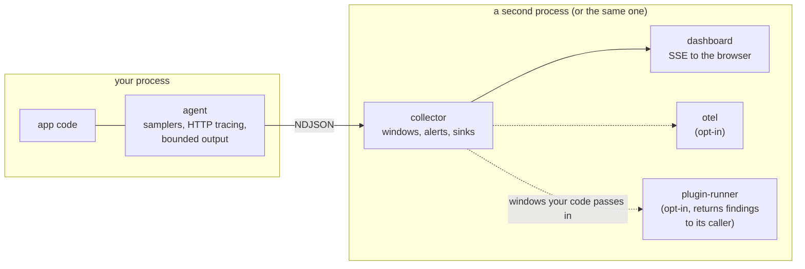

<p align="center">
  
</p>

<h1 align="center">Phargus</h1>

<p align="center"><strong>All-seeing runtime diagnostics for Node.js.</strong></p>

<p align="center">
  One line in your process. Event loop lag, memory, GC, stream backpressure and request traces.<br>
  Zero dependencies in the agent, no hosted account, no separate backend.
</p>

<p align="center">
  <a href="https://www.npmjs.com/package/@pharn-dev/phargus"></a>
  <a href="https://github.com/pharn-dev/phargus/actions/workflows/ci.yml"></a>
  <a href="https://github.com/pharn-dev/phargus/actions/workflows/codeql.yml"></a>
  <a href="https://github.com/pharn-dev/phargus/actions/workflows/gitleaks.yml"></a>
  <a href="./LICENSE"></a>
  <a href="./package.json"></a>
</p>

```bash
npm install @pharn-dev/phargus
node --import @pharn-dev/phargus/agent app.mjs | npx phargus serve
```

<p align="center">
  
</p>

> **Status:** published on npm (the npm badge above shows the current version; 0.1.0, the first
> release, was published 2026-10-12). `main` can be ahead of the latest release: those changes are
> listed under `Unreleased` in [`CHANGELOG.md`](./CHANGELOG.md). Roadmap steps S0 to S7 are implemented (agent, collector,
> dashboard, tracing, V8 and memory depth, plugin runner, OpenTelemetry export; see
> [`ROADMAP.md`](./ROADMAP.md)).

## Contents

- [Why Phargus](#why-phargus)
- [Quick start](#quick-start)
- [Agent skills](#agent-skills)
- [Configuration](#configuration)
- [What you get](#what-you-get)
- [How it fits together](#how-it-fits-together)
- [Safety and limits](#safety-and-limits)
- [Documentation](#documentation)
- [Contributing](#contributing)
- [Security](#security)
- [License](#license)

---

## Why Phargus

Phargus is for a quick look at a live process: one line, in-process, no account.

|                     | One-line setup | Runs in the live process | Needs an account  | Analysis              |
| ------------------- | -------------- | ------------------------ | ----------------- | --------------------- |
| [clinic.js][clinic] | no             | one-shot capture         | no                | offline, after        |
| OpenTelemetry       | no             | yes                      | no, but a backend | in your backend       |
| Hosted APMs         | yes            | yes                      | **yes**, and paid | in the vendor's UI    |
| **Phargus**         | **yes**        | **yes**                  | **no**            | live, in your browser |

The agent's zero-dependency rule is never relaxed: `src/agent` imports Node core only, and an ESLint
rule enforces it.

[clinic]: https://clinicjs.org/

---

## Quick start

**Requires Node.js 22.18 or newer** (`engines.node` is `>=22.18.0`; [`.nvmrc`](./.nvmrc) pins the
tested floor). On Node 22, request tracing is noticeably more expensive for promise-heavy code than
on Node 24; see [`docs/LIMITS.md`](./docs/LIMITS.md#1-cost-and-overhead).

Two commands: install the package, then run your app with the agent and pipe its output into
`phargus serve`.

```bash
npm install @pharn-dev/phargus
node --import @pharn-dev/phargus/agent app.mjs | npx phargus serve
```

`phargus serve` prints `phargus: dashboard at http://127.0.0.1:7070` on stderr; open that address.
Your app's stdout is the pipe, so it may log there too: lines that are not agent data are copied
to `phargus serve`'s stdout, so your app's own output still reaches the terminal
(`--no-passthrough` turns that off). When the app exits, the dashboard keeps serving what it collected until you press
Ctrl-C.

With `node:cluster` or forked children, every process inherits the agent and the pipe, but the
runtime figures follow one process only; see
[`docs/LIMITS.md`](./docs/LIMITS.md#2-in-process-so-shared-fate).

### Other ways to load the agent

For a CommonJS app, use `--require` instead of `--import`:

```bash
node --require @pharn-dev/phargus/agent app.js | npx phargus serve
```

Or load the agent in code, first, before your own code:

```js
// CommonJS
require('@pharn-dev/phargus/agent');

// ESM
import '@pharn-dev/phargus/agent';
```

By default the agent writes one sample line per second (about 450 bytes) to **your process's
stdout**, plus one line per traced request. That is all the agent does on its own: it starts no server.
`phargus serve` (below), or a collector you wire yourself, turns that stream into the dashboard.

### The live dashboard

#### `phargus serve`

```text
phargus serve [options] [file|-]
```

| Option                  | Default     | Meaning                                                                                                                    |
| ----------------------- | ----------- | -------------------------------------------------------------------------------------------------------------------------- |
| `--port <n>`            | `7070`      | Port to listen on, `0` to `65535`. `0` picks a free port.                                                                  |
| `--host <address>`      | `127.0.0.1` | Address to bind. A non-loopback host needs a token.                                                                        |
| `--token <value>`       | none        | Require a token. Non-loopback hosts need at least 16 characters. Prefer `PHARGUS_TOKEN`: a flag shows in the process list. |
| `--allowed-host <host>` | none        | Also answer this `Host` name. Repeatable; `host:port` matches exactly.                                                     |
| `--window-ms <n>`       | `1000`      | Aggregation window in milliseconds.                                                                                        |
| `--max-line-bytes <n>`  | `1048576`   | Longest accepted input line in bytes.                                                                                      |
| `--no-passthrough`      |             | Do not copy the app's own lines to stdout.                                                                                 |
| `--alert <rule>`        | none        | Raise an alert: `<metric><op><threshold>[:<windows>]`, for example `eventLoop.p99>50ms:3`. Repeatable.                     |
| `-h`, `--help`          |             | Print the usage text.                                                                                                      |
| `-v`, `--version`       |             | Print the version.                                                                                                         |

- **Input.** stdin by default (or `-`). Give a file path to replay a capture: redirect the app's
  stdout to a file, then run `npx phargus serve capture.ndjson`. The server keeps running after
  the input ends, serving what it collected, until you stop it.
- **Token.** On loopback no token is needed. For any other `--host` set one with at least 16
  characters; generate a random token with `openssl rand -hex 16`. For example,
  `PHARGUS_TOKEN=$(openssl rand -hex 16) npx phargus serve --host 0.0.0.0`; without a token or
  with a shorter one, the command exits with code 2 before binding. `PHARGUS_TOKEN` and
  `PHARGUS_DEBUG` belong to `phargus serve`; the agent ignores both, so they can sit in an
  environment shared with the app. See **Dashboard access**
  under [Using the library APIs](#using-the-library-apis) for how browsers and scripts present the
  token.
- **Reaching it from another machine.** The server answers only the `Host` names listed under
  **Dashboard access**; any other gets `421`. When the browser uses a different IP or hostname,
  for example with `--host 0.0.0.0` in a container, name it with `--allowed-host` and repeat the
  flag for several names:

  ```bash
  PHARGUS_TOKEN=... npx phargus serve --host 0.0.0.0 \
    --allowed-host dash.internal --allowed-host 192.0.2.10
  ```

  A bare name matches on any port, so it also works behind a port mapping; `host:port` matches
  only that port. The value is a host, not a URL: an empty value, whitespace or `/` is a usage
  error (exit `2`). `--allowed-host` does not replace the token: a name that is not loopback needs
  one of at least 16 characters even with the default loopback `--host`, or the command exits with
  code 2 before binding.
  The dashboard is plain HTTP, so across an untrusted network still use an SSH tunnel or a
  TLS-terminating proxy.

- **The app's own output passes through to stdout.** When the input is stdin, every line that is
  not agent data (plain text and JSON log lines) is written to `phargus serve`'s stdout, in input
  order, with a newline. Agent lines, lines longer than `--max-line-bytes` and malformed agent
  records are not echoed. Passthrough is off for a file input; `--no-passthrough` turns it off for
  stdin. When more than 1 MiB is waiting to be written (a slow or stuck reader), further lines are
  dropped and counted (not on Windows, where a stuck reader blocks the process; see
  [`docs/LIMITS.md`](./docs/LIMITS.md)); if stdout closes (`EPIPE`), passthrough stops with one
  stderr line and the server keeps running.
- **Alerts from the command line.** `--alert '<metric><op><threshold>[:<windows>]'` defines a
  collector alert rule; repeat the flag for several rules. `<metric>` is a window field such as
  `eventLoop.p99`, `eventLoop.max`, `memory.rssLast`, `gc.maxPause` or `backpressure.maxStall`
  (`--alert` with an unknown name lists them all). `<op>` is `>` or `>=`. `<threshold>` is an
  integer in the metric's own unit (nanoseconds, bytes or a count), or with a unit: `ms` or `s`
  for the time metrics, `MiB` or `GiB` for the memory metrics. `:<windows>` makes the rule fire
  only after that many consecutive windows (default 1). Each rule prints one stderr line when it
  fires and one when it resolves, and the dashboard's Alerts panel shows both:

  ```bash
  node --import @pharn-dev/phargus/agent app.mjs | npx phargus serve --alert 'eventLoop.p99>50ms:3'
  npx phargus serve --alert 'memory.rssLast>=512MiB' capture.ndjson
  ```

  An unknown metric, another operator, a bad number or unit, a unit that does not fit the metric,
  or the same rule twice is a usage error (exit `2`). Quote the value: `>` is a shell redirect.

- **Diagnostics go to stderr only.** The dashboard URL, a line when the input ends, and a
  `counts:` line when the input ends and again at exit: `decoder.invalid` (text lines),
  `decoder.oversized`, `decoder.foreign` (JSON objects that are not agent records, such as JSON
  log lines), `collector.ignored` (agent-shaped records it could not use),
  `dashboard.droppedEvents`, `passthrough.dropped` (lines not echoed because 1 MiB was already
  waiting), and `agent.droppedSamples` and `agent.droppedSpans` (the agent's own drop counters,
  from the latest window). Errors print without a stack; set `PHARGUS_DEBUG=1` to get one.
- **Exit codes.** `0` for help, version and a graceful stop on `SIGINT` or `SIGTERM`; `1` for a
  runtime error (unreadable file, port in use) or a shutdown that did not finish in 5 seconds;
  `2` for a usage error (unknown flag, bad value, non-loopback host without a token).

#### Using the library APIs

To embed the collector and dashboard in your own process, wire `@pharn-dev/phargus/collector` and
`@pharn-dev/phargus/dashboard` yourself. A minimal version, which is what `phargus serve` does:

```js
// collect.mjs — run as: node --import @pharn-dev/phargus/agent app.mjs | node collect.mjs
import { pipeline } from 'node:stream/promises';
import { createCollector, createNdjsonDecoder } from '@pharn-dev/phargus/collector';
import { createDashboardServer } from '@pharn-dev/phargus/dashboard';

const collector = createCollector({ windowMs: 1000, capacity: 300 });
const dashboard = await createDashboardServer({ collector, host: '127.0.0.1', port: 7070 });
process.stderr.write(`phargus dashboard on ${dashboard.url}\n`);
const decoder = createNdjsonDecoder();
await pipeline(process.stdin, decoder, (records) => collector.consume(records));
```

Your app may write to the same stdout. Lines that are not JSON objects (plain text, truncated
lines) and lines longer than `maxLineBytes` (1 MiB by default) are skipped and counted as
`decoder.invalid` and `decoder.oversized`; JSON objects that are not agent records, such as the
lines of a JSON logger, and agent-shaped records that cannot be aggregated are skipped and counted
as `collector.ignored`. Neither is thrown. Pass `onSkipped` to `createNdjsonDecoder` or `onIgnored`
to `createCollector` to see each skipped line or record. With `createNdjsonDecoder({ agentOnly:
true })` the decoder skips JSON objects that are not agent records itself, counts them as
`foreign` and reports them through `onSkipped` with their raw line, in input order with the text
lines; this is how `phargus serve` passes the app's output through.

[`examples/express-app`](./examples/express-app) is the complete version: it forks the app, reads
its stdout into a collector with an alert rule, serves the dashboard, and shuts both down cleanly.
The recording above is that example.

**Dashboard access.**

- On a loopback address (`127.x.x.x`, `localhost`, `::1`) the token is optional, unless
  `allowedHosts` names a host that is not loopback. Binding any other address, or allowing such a
  name, requires a token with at least 16 characters; generate one with `openssl rand -hex 16`.
  A shorter token is refused at startup. Use a hex or base64url token; any other character can be
  percent-encoded in the login link (`+` as `%2B`).
- With a token, open `http://<host>:<port>/login#token=<token>` once in a browser. The token is in
  the URL fragment, which the browser never sends to the server. The login page removes the
  fragment from the address bar and history, then posts the token to `POST /session` in a JSON
  body; the server answers `204` with an `HttpOnly`, `SameSite=Strict` cookie and the page opens
  `/`. A wrong token gets `401` and no cookie.
- Scripts and `curl` send `Authorization: Bearer <token>`, for example to `/events`.
- The server answers only requests whose `Host` is the bound address on the bound port (plus
  `localhost`, `127.0.0.1` and `[::1]` for a loopback or `0.0.0.0`/`::` bind); anything else gets
  `421`. A cross-origin `Origin` on `/events` gets `403`. Behind a reverse proxy, or when you
  reach the dashboard by another name, list that name in `allowedHosts` (`--allowed-host` for
  `phargus serve`). A name that is not loopback requires a `token` of at least 16 characters, even on a loopback
  bind.
- The dashboard is plain HTTP. For remote access use an SSH tunnel or a TLS-terminating proxy.

---

## Agent skills

If you work with a coding agent, [`pharn-dev/skills`](https://github.com/pharn-dev/skills) ships a
`phargus` plugin that sets up and diagnoses Phargus for you. Ask in plain language; the agent picks
the skill.

| Skill              | What it does                                                                                        |
| ------------------ | --------------------------------------------------------------------------------------------------- |
| `phargus-setup`    | Connects Phargus to your app and verifies the dashboard receives real samples                       |
| `phargus-diagnose` | Investigates slow requests, event-loop stalls, GC pressure and stream backpressure                  |
| `phargus-verify`   | Compares before and after measurements and says whether a fix helped, regressed or is inconclusive  |
| `phargus-memory`   | Separates heap, RSS and buffer growth and reads heap snapshot summaries and diffs                   |
| `phargus-rules`    | Turns an observed condition into a collector alert or sandboxed rule, replayed before you enable it |

Install for Claude Code:

```text
/plugin marketplace add pharn-dev/skills
/plugin install phargus@pharn-dev
```

Or for any supported agent with the [Skills CLI](https://github.com/vercel-labs/skills):

```bash
npx skills add pharn-dev/skills
```

The skills are a development draft targeting the 0.1.x runtime; see the
[skills README](https://github.com/pharn-dev/skills#readme) for Codex and compatibility details.

---

## Configuration

Choose where the agent writes with `PHARGUS_OUTPUT`:

| Variable                   | Default    | Meaning                                                                                        |
| -------------------------- | ---------- | ---------------------------------------------------------------------------------------------- |
| `PHARGUS_OUTPUT`           | `stdout`   | `stdout`, `none` (agent off), or a file path                                                   |
| `PHARGUS_OUTPUT_MAX_BYTES` | `67108864` | size bound of a file output (64 MiB): at the bound it is renamed to `<file>.1`; `0` = no bound |
| `PHARGUS_INTERVAL_MS`      | `1000`     | sampling interval                                                                              |
| `PHARGUS_QUEUE_BOUND`      | `1024`     | lines held per output queue before the oldest are dropped                                      |
| `PHARGUS_SPAN_BUFFER`      | `1024`     | spans kept per interval, 0 to 65536; `0` turns request tracing off, samplers stay on           |
| `PHARGUS_ENABLED`          | `true`     | `false` or `0` turns the agent off: nothing is patched and no config file is read              |
| `PHARGUS_CONFIG`           | none       | path to the one `.json` config file to load; skips the working-directory lookup                |

The same keys (`output`, `outputMaxBytes`, `intervalMs`, `queueBound`, `spanBuffer`, `enabled`)
can go in `phargus.config.json` in the working directory. The file is JSON only and is parsed,
never executed: a `phargus.config.js` is not read, and the agent prints one warning naming
`phargus.config.json` when it finds one. An unknown `PHARGUS_*` variable prints one warning on
stderr that lists the valid names, and is ignored; `PHARGUS_TOKEN` and `PHARGUS_DEBUG`, which
belong to `phargus serve`, are ignored without a warning. When `PHARGUS_CONFIG` is set,
`phargus.config.json` in the working directory is not read, and a problem with the pinned file
(including an extension other than `.json`) disables the agent like any invalid value. An invalid value disables the agent with one
`[phargus] agent disabled: ...` line on stderr; your app keeps running. `PHARGUS_ENABLED=false`
or `PHARGUS_OUTPUT=none` turns the agent off before it patches anything or reads a config file.
`enabled: false` or `output: "none"` in a config file is only known once the file is read, so
request tracing is switched on until then.

A file output never grows past `PHARGUS_OUTPUT_MAX_BYTES`: before a line would take it past the
bound, the agent renames it to `<file>.1` (replacing an older `.1`) and continues in a new file
created with mode `0600`, so at most twice the bound is on disk. Rotation happens between lines,
so no line is split. If the rename fails, the agent is disabled with one
`[phargus] agent disabled: ...` line.

`PHARGUS_SPAN_BUFFER=0` keeps the samplers and the backpressure probe and drops request tracing,
its per-request CPU cost included: nothing wraps `http.Server`, no span line is written and
`currentTraceId()` returns `undefined`. Like `PHARGUS_ENABLED`, the variable is read before
anything is patched; `spanBuffer: 0` in a config file switches tracing off once the file is read.
Any other value caps the span lines written per interval; the rest are counted in the sample
line's `dropped.spans`. A smaller buffer also shortens the burst each tick spends serializing
spans under load (see [`docs/LIMITS.md`](./docs/LIMITS.md) §1).

---

## What you get

| Capability          | What it covers                                                                                                                                                                                                                                                                                                                | Import                             |
| ------------------- | ----------------------------------------------------------------------------------------------------------------------------------------------------------------------------------------------------------------------------------------------------------------------------------------------------------------------------- | ---------------------------------- |
| **Runtime samples** | Event loop delay beyond the 10 ms timer interval (min, max, mean, p50, p99; an idle loop reads close to 0); memory (`heapUsed`, `heapTotal`, `rss`, `external`, `arrayBuffers`); GC count, total and max pause and counts by kind (V8 heap space statistics: `sampleHeapSpaces()`, not on the line)                           | `@pharn-dev/phargus/agent`         |
| **Backpressure**    | How often and how long writes stalled, grouped by the call site that wrote. Covers `Writable` subclasses, `fs.WriteStream`, `Duplex`, `Transform`, `PassThrough`, `net.Socket`, `tls.TLSSocket`, `http.ServerResponse` and `http.ClientRequest`                                                                               | `@pharn-dev/phargus/agent`         |
| **Request tracing** | Each request to a `node:http` or `node:https` server gets a trace id, carried by `AsyncLocalStorage` with no code change; an inbound `traceparent` sets its trace id and parent span id. Spans record method, the first 256 characters of the requested path (no query), status and duration. `currentTraceId()` reads the id | `@pharn-dev/phargus/agent`         |
| **Loss accounting** | Output queues are bounded and drop the oldest lines; every sample line carries cumulative `dropped: { samples, spans }` counters                                                                                                                                                                                              | `@pharn-dev/phargus/agent`         |
| **V8 and memory**   | On-demand heap snapshots (`takeHeapSnapshot`), allocation sampling (`sampleAllocations`) and a `node --trace-deopt` output parser (`createDeoptParser`, you feed it the lines); snapshot summaries, diffs and stack-trace symbolization in a Worker Thread pool come from `@pharn-dev/phargus/analyzer`                       | `@pharn-dev/phargus/agent`         |
| **Collector**       | Fixed time windows with integer math, threshold alerts, alert sinks (stdout, file, webhook), opt-in persistence of recent windows to an append-only file                                                                                                                                                                      | `@pharn-dev/phargus/collector`     |
| **Dashboard**       | Vanilla JS, no framework, no bundler, live over Server-Sent Events: latest event loop, memory, GC and backpressure figures with the top stalling call sites, alerts, and a waterfall of recent requests                                                                                                                       | `@pharn-dev/phargus/dashboard`     |
| **Custom rules**    | User rules run in an `isolated-vm` sandbox in a child process, with a memory limit, a timeout and capped results. `isolated-vm` is an optional peer dependency                                                                                                                                                                | `@pharn-dev/phargus/plugin-runner` |
| **OpenTelemetry**   | Opt-in OTLP/HTTP JSON export of windows as metrics and spans as traces, batched into bounded requests with dropped items counted, using Node core `fetch` only                                                                                                                                                                | `@pharn-dev/phargus/otel`          |

[`FEATURES.md`](./FEATURES.md) lists the full scope with the status of each item.

### OpenTelemetry metrics

`createOtlpMetricsExporter` (or `toOtlpMetrics`) turns each collector window into one data point
per metric, as integer `asInt` values. Gauges are stamped at the window end. Sums are delta and
monotonic, and their interval is the window.

| Metric                             | Type  | Unit           | Window field              |
| ---------------------------------- | ----- | -------------- | ------------------------- |
| `phargus.event_loop.lag.max`       | gauge | `ns`           | `eventLoop.max`           |
| `phargus.event_loop.lag.p99`       | gauge | `ns`           | `eventLoop.p99`           |
| `phargus.event_loop.lag.mean`      | gauge | `ns`           | `eventLoop.mean`          |
| `phargus.memory.heap_used.last`    | gauge | `By`           | `memory.heapUsedLast`     |
| `phargus.memory.heap_used.max`     | gauge | `By`           | `memory.heapUsedMax`      |
| `phargus.memory.rss.last`          | gauge | `By`           | `memory.rssLast`          |
| `phargus.memory.rss.max`           | gauge | `By`           | `memory.rssMax`           |
| `phargus.gc.pause.max`             | gauge | `ns`           | `gc.maxPause`             |
| `phargus.backpressure.stall.max`   | gauge | `ns`           | `backpressure.maxStall`   |
| `phargus.gc.count`                 | sum   | `{collection}` | `gc.count`                |
| `phargus.gc.pause.total`           | sum   | `ns`           | `gc.totalPause`           |
| `phargus.backpressure.events`      | sum   | `{event}`      | `backpressure.events`     |
| `phargus.backpressure.stall.total` | sum   | `ns`           | `backpressure.totalStall` |
| `phargus.window.samples`           | sum   | `{sample}`     | `count`                   |
| `phargus.window.late_samples`      | sum   | `{sample}`     | `late`                    |

The resource carries `service.name` (option `serviceName`, default `phargus`),
`service.instance.id` (option `serviceInstanceId`, default a random UUID generated once per
process), `host.name` and `process.pid`, so several instances of one service stay separate series.
`host.name` and `process.pid` describe the process that runs the exporter. In the usual setup that
is the collector process you wire the exporter into, not the monitored app, so they identify the
collector; set `serviceInstanceId` when you need to tell the monitored instances apart.
The trace exporter's resource still carries `service.name` only.

---

## How it fits together



The agent never waits for the consumer: if the reader is slow, the agent drops the oldest queued
lines and counts them, so a slow consumer cannot slow your app. On Windows, where Node writes a
stdout pipe synchronously, the agent writes that pipe itself from libuv's thread pool, so a stalled
reader holds one pool thread until it reads again (see [`docs/LIMITS.md`](./docs/LIMITS.md)).

Phargus is one npm package: the six modules are subpath exports, shipped as both ESM and CommonJS.
`analyzer` runs its CPU-heavy work in Worker Threads. See [`ARCHITECTURE.md`](./ARCHITECTURE.md) for
the data flow and module boundaries.

---

## Safety and limits

| Claim                                      | The check behind it                                                                                                                                                                                                                                                                                                                       |
| ------------------------------------------ | ----------------------------------------------------------------------------------------------------------------------------------------------------------------------------------------------------------------------------------------------------------------------------------------------------------------------------------------- |
| The agent has no third-party dependencies  | An ESLint rule limits `src/agent` to `node:` builtins and its own files, and bars imports from the other modules                                                                                                                                                                                                                          |
| Every subpath loads as ESM and as CommonJS | `npm run check:exports` loads each `exports` entry via `import` and `require`                                                                                                                                                                                                                                                             |
| The published tarball is what we intend    | `npm run check:package` checks tarball contents, source maps and `engines.node` against `.nvmrc`                                                                                                                                                                                                                                          |
| Overhead is measured, not assumed          | `bench/overhead.mjs` (agent on versus off, several HTTP workloads) and `bench/soak.mjs` (leaks under load), run nightly. The benchmark fails the nightly run when a low-variance run exceeds its budget; it is not a required check and never blocks a merge, so measure on your own workload. See [`bench/README.md`](./bench/README.md) |
| No secrets in the repository               | gitleaks on every push, plus CodeQL                                                                                                                                                                                                                                                                                                       |

- **Prototype patches are inert when disabled and never throw.** The backpressure probe wraps
  `write` on the stream prototypes and tracing wraps `Server.prototype.emit`, once per process.
  When the agent disables itself the wrappers stay in place and pass every call straight through,
  so a wrapper another library installed later keeps working.
- **The agent runs under the Node permission model.** The flags each module needs are in
  [`docs/PERMISSIONS.md`](./docs/PERMISSIONS.md).
- **Heap snapshots and traces can contain sensitive data.** See [`SECURITY.md`](./SECURITY.md),
  [`docs/THREAT-MODEL.md`](./docs/THREAT-MODEL.md) and [`docs/LIMITS.md`](./docs/LIMITS.md).

---

## Documentation

| Document                                         | What is in it                                     |
| ------------------------------------------------ | ------------------------------------------------- |
| [`FEATURES.md`](./FEATURES.md)                   | Full feature scope and status                     |
| [`ARCHITECTURE.md`](./ARCHITECTURE.md)           | Data flow and who may import what                 |
| [`docs/API.md`](./docs/API.md)                   | Every supported export, per subpath               |
| [`docs/PERMISSIONS.md`](./docs/PERMISSIONS.md)   | Node permission-model flags per module            |
| [`docs/LIMITS.md`](./docs/LIMITS.md)             | Cost, overhead and known limits                   |
| [`docs/THREAT-MODEL.md`](./docs/THREAT-MODEL.md) | What Phargus defends against and what it does not |
| [`ROADMAP.md`](./ROADMAP.md)                     | Build order and status                            |
| [`CHANGELOG.md`](./CHANGELOG.md)                 | Release notes                                     |

---

## Contributing

Contributions are welcome. Start with [`CONTRIBUTING.md`](./CONTRIBUTING.md), which lists the rules
pull requests are checked against and how to build from source, then [`CLAUDE.md`](./CLAUDE.md) for
the hard constraints. Look for issues labeled `good-first-issue`. By participating you agree to
follow the [Code of Conduct](./CODE_OF_CONDUCT.md).

## Security

Please do not open public issues for vulnerabilities. Report them privately as described in
[`SECURITY.md`](./SECURITY.md).

## License

[Apache-2.0](./LICENSE)
